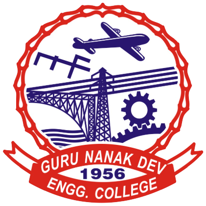

  

<h1 align="center">Centre of Excellence in Structural Designing</h1>

<h3 align="center">Department of Civil Engineering</h3>

<h3 align="center">Guru Nanak Dev Engineering College, Ludhiana</h3>

  
  
  

---

## About the Centre

The <strong>Centre of Excellence in Structural Designing (CoE-SD)</strong> is an initiative of the Department of Civil Engineering, Guru Nanak Dev Engineering College (GNDEC), Ludhiana, supported by <strong>TATA</strong>.

The Centre is envisioned as an experiential learning and knowledge-sharing facility dedicated to promoting a deeper understanding of structural engineering through physical demonstrations, interactive digital visualisations, structural models and practical learning resources.

Its primary objective is to bridge the gap between theoretical knowledge and practical construction practices by enabling students, faculty members and industry professionals to <strong>observe, visualise, interact, understand and apply</strong> fundamental structural engineering concepts.

## Vision

To establish an interactive learning environment that promotes sound structural design, appropriate reinforcement detailing, construction quality, structural safety and industry–academia collaboration.

## Key Focus Areas

- **Structural Demonstrations:** Physical models, reinforced concrete components, reinforcement detailing and structural systems.
- **Digital Learning:** Interactive three-dimensional visualisations, animations and digital educational displays.
- **Construction Practices:** Demonstrations of appropriate detailing, construction quality and common construction deficiencies.
- **Experiential Learning:** Technical demonstrations, workshops, training programmes and academic visits.
- **Industry–Academia Collaboration:** Engagement with industry professionals, technical experts and other stakeholders.

## Repository Documentation

This repository serves as the official documentation space for the planning, development, implementation and activities of CoE-SD.

| Folder / File | Description |
|:---|:---|
| `Meeting_Notes/` | Records of project discussions, conceptualisation and meeting reports. |
| `Meeting_Notes/18.11.2026.md` | Project Discussion & Conceptualisation Report dated 18 November 2026. |
| `Images/` | Institutional logo and project-related photographs and visual documentation. |

Additional documentation, photographs, installation details, educational resources and progress reports will be added as the Centre develops.

## Project Coordination

| Responsibility | Faculty Member |
|:---|:---|
| **Head of Department** | Dr. Harvinder Singh |
| **Incharge, CoE-SD** | Dr. Yuvraj Singh |
| **Department** | Civil Engineering |
| **Institution** | Guru Nanak Dev Engineering College, Ludhiana |

## Contact

For project-related queries, coordination, technical discussions or further information, please contact:

**Dr. Yuvraj Singh**  
Incharge – Centre of Excellence in Structural Designing (CoE-SD)  
Department of Civil Engineering  
Guru Nanak Dev Engineering College, Ludhiana

- **Mobile:** [+91 98158 30889](tel:+919815830889)
- **Email:** [uvraj_23@yahoo.co.in](mailto:uvraj_23@yahoo.co.in)

---

  <strong>Centre of Excellence in Structural Designing (CoE-SD)</strong> 
  Department of Civil Engineering 
  Guru Nanak Dev Engineering College, Ludhiana

  Advancing Structural Engineering Education through Experiential Learning and Industry Collaboration

